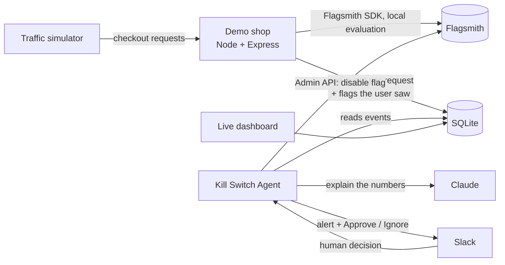

# Kill Switch Agent

**When a new feature breaks production, this agent finds the feature flag responsible and asks a human in Slack to switch it off. One tap, and Flagsmith turns it off for everyone.**

Built for *Toggle Wars: The Flagsmith Experimentation Hackathon*, Track 02 (AI Agents and Feature Flags).

## The problem

Teams ship new features behind flags so they can roll back fast. But at 2 AM someone still has to notice the errors, work out which feature caused them, find the right flag and switch it off. That takes 20 to 40 minutes. The Kill Switch Agent cuts it to one tap in Slack, and a human still makes the final call.

## Who decides what

| Step | Done by | Why |
| --- | --- | --- |
| Spot an error spike | **Maths**, every 10s | Fast, free, never tired |
| Investigate: which flag, who is failing, what the errors say, what changed in Flagsmith | **Claude**, with read-only tools (Flagsmith MCP + event data) | Judgement: tells a feature bug from an attack or an outage |
| Propose one action: turn off flag, block sources, escalate, keep watching | **Claude** | |
| Check the proposal against the evidence | **Guardrails** (plain code) | Claude can't offer a kill the numbers don't back, or block someone who isn't causing errors |
| Approve | **A human**, in Slack | Every change to Flagsmith needs a person |
| Switch the flag off and confirm recovery | **The agent**, through the Flagsmith Admin API | Only after approval |

Claude never gets a tool that changes Flagsmith. Its Flagsmith MCP tools are a read-only allow-list (`get_feature_flag`, `list_project_features`, segment reads, and so on); `update_*`, `create_*` and `delete_*` are never exposed. If Claude is slow or unavailable, the alert still goes out from the numbers alone.

## Track 02 criteria at a glance

| Judges look for | How this project does it |
| --- | --- |
| Flagsmith CLI, API or MCP server | **All three ways in:** the **Flagsmith MCP server** gives the investigator read-only access (`src/flagsmithMcp.js`), the **Admin API** switches the flag off (`src/flagsmithAdmin.js`), and the **Node SDK** with local evaluation serves per-user flags (`src/flags.js`). |
| Saves real time | The investigator finishes in 5–11 seconds. Detects the guilty flag within about 10s of errors starting. One tap switches it off. The agent then measures how long Flagsmith takes to deliver the change (about 35s in our live test) and confirms recovery. The dashboard and each report show the measured times. |
| A human approves changes | The agent never changes a flag on its own. It also spots attacks meant to trick it into a rollback, and suggests blocking the attacker instead. Slack **Turn off** button with a confirm dialog, plus an optional approver list. The dashboard backup unlocks only if Slack isn't set up or is down. |
| Clear output | The investigation steps and Claude's reasoning on every alert, a 3-line Slack alert with the ON vs OFF evidence, a recovery summary in the thread, a Markdown **incident report** per incident (`reports/incident-N.md`), and a live dashboard. |

## How it works



1. **Every request is tagged with its flags.** The shop asks Flagsmith which flags this user has, runs the new or old checkout, and logs `success/error + {new_checkout: true, ...}`.
2. **The agent watches.** Every 10 seconds it looks at the last 30 seconds of traffic. If errors pass 5%, it splits users into *flag ON* vs *flag OFF* for each flag.
3. **It finds the guilty flag with simple maths.** If ON users fail at least 3x more than OFF users, with enough traffic on both sides, that flag is the suspect. If no flag explains it (say, the database is down), it says so and blames nothing.
4. **Claude explains, a human decides.** Claude turns the numbers into a 3-line alert. Slack shows it with **Turn off** and **Ignore** buttons. The agent never changes a flag on its own.
5. **Kill.** On approval the agent calls the Flagsmith Admin API and disables the flag for the whole environment. The app's SDK picks it up within seconds.
6. **Verify and report.** The agent waits until the app stops serving the flag (it measures how long Flagsmith took to deliver the change), then checks the error rate again, posts a summary (before and after, who approved, time to recovery) and writes `reports/incident-N.md` with the evidence table and full timeline. Every step goes to an audit log.

## How we used Flagsmith

| What | Where in the code | Why |
| --- | --- | --- |
| `new_checkout` flag | `src/app.js` → `flags.new_checkout ? newCheckout() : oldCheckout()` | The risky new feature |
| `new_search_banner` flag | `src/app.js` | An innocent second flag, which proves the agent blames the right one |
| % split segment overrides (holdouts) | Set up in the Flagsmith dashboard | Keeps a share of users on the old version, so ON vs OFF can be compared |
| Node SDK `@flagsmith/nodejs` with **local evaluation** | `src/flags.js` → `getIdentityFlags(userId)` | Per-user flag values evaluated in memory, refreshed every 5s, so a kill reaches the app fast |
| Default flag handler | `src/flags.js` | If Flagsmith is unreachable, new features fail safe to OFF |
| **Admin API**, Organisation API key | `src/flagsmithAdmin.js` → `PATCH /api/__future__/environments/{env}/features/{id}/` with `{"environment_default": {"enabled": false}}`, falling back to v1 `featurestates` | The kill switch itself |
| Admin API read | `src/flagsmithAdmin.js` → `getFlagState()` | Never asks to kill a flag that's already off; shown on the dashboard |
| Flagsmith audit log | Flagsmith dashboard | Every kill made through the API is recorded by Flagsmith as well |

## Run it

Requirements: Node.js 20+.

```bash
npm install
cp .env.example .env      # Windows: copy .env.example .env
```

### Option A: try it in 1 minute, no accounts (local test mode)

Set `LOCAL_TEST_MODE=true` in `.env`, then:

```bash
npm start -- --sim        # shop + agent + traffic simulator
```

Open http://localhost:3000, click **Break new checkout**, wait for the incident, click **Approve**. Flags live in `data/local-flags.json` in this mode, so use it only to try the code.

### Option B: the real thing with Flagsmith and Slack

**1. Flagsmith** (free account at [app.flagsmith.com](https://app.flagsmith.com))

1. Create a project (e.g. *Kill Switch Demo*). Use its *Development* environment.
2. Create two flags, both **enabled**: `new_checkout` and `new_search_banner`.
3. Create segment `checkout_holdout` with one rule: **% Split = 20**. On `new_checkout`, add a segment override for it: **disabled**.
4. Create segment `banner_holdout`: **% Split = 50**. On `new_search_banner`, override: **disabled**.
5. Copy into `.env`:
   - `FLAGSMITH_SERVER_KEY`: Environment settings → SDK keys → create a **server-side** key (`ser.…`)
   - `FLAGSMITH_ENVIRONMENT_KEY`: the environment's client-side key (also in the dashboard URL)
   - `FLAGSMITH_PROJECT_ID`: the number in the dashboard URL after `/project/`
   - `FLAGSMITH_ADMIN_API_KEY`: Organisation settings → API Keys → create one

**2. Slack** (optional; without it you approve on the dashboard)

1. [api.slack.com/apps](https://api.slack.com/apps) → Create New App → From scratch.
2. **Socket Mode** → enable → create an App-Level Token with `connections:write` → `SLACK_APP_TOKEN` (`xapp-…`).
3. **OAuth & Permissions** → Bot Token Scopes: `chat:write` → Install to workspace → `SLACK_BOT_TOKEN` (`xoxb-…`).
4. **Interactivity & Shortcuts** → turn on (Socket Mode needs no URL).
5. Create a channel such as `#incidents`, run `/invite @YourApp` there, and copy its channel ID → `SLACK_CHANNEL_ID`.
6. Optional: `SLACK_APPROVER_IDS` = your Slack member ID, so only you can approve.

**3. Claude** (recommended): set `ANTHROPIC_API_KEY`. It powers the investigator. Without it, alerts are raised from the numbers alone with a template message.

**4. Check and run**

```bash
npm run check             # tests Flagsmith, Slack and Claude, and says exactly what's wrong
npm start -- --sim
```

Then click **Break new checkout** on the dashboard and approve in Slack.

Before recording a demo, run `npm run clean` (with the app stopped) to clear old incidents, and click **Reset demo** so the flag is back ON.

## Tests

**Investigator eval with real Claude:** `npm run eval` runs 5 scenarios 3 times each and saves a scorecard to `eval-results.md`.

Latest result: **15/15 correct** with `claude-sonnet-5-5` using the live Flagsmith MCP server (7 read-only tools). Each investigation took 5–11 seconds and 4–6 checks.

| Scenario | Correct proposal | Result |
| --- | --- | --- |
| New checkout bug | Turn off `new_checkout` | 3/3 |
| Attack from 3 accounts | Block those sources | 3/3 |
| Database outage | Escalate: no flag at fault | 3/3 |
| Bug and attack at once | Turn off `new_checkout` | 3/3 |
| Two flags changed, one broken | Turn off `new_checkout` only | 3/3 |

An earlier run scored 12/15. In all three misses, the investigator spotted that our test data was broken: the "attack" scenario was accidentally failing 100% of requests with gateway timeouts. It correctly escalated it as an outage and explained why. We fixed the test data and added a sanity check.


```bash
npm test
```

Unit tests (11) cover the blame logic and abuse protection: attack-only is flagged as possible abuse (even from many IPs), a spread-out bug is still blamed, a bug plus an attack still finds the bug, and fewer than 10 affected users is never blamed. Earlier tests cover no false alarm on normal traffic or low traffic, blaming the right flag and not the innocent one, waiting for more data instead of raising a false alarm, reporting "no flag to blame" when everything fails, and flags with no OFF group.

End-to-end scenarios checked in local test mode: attack only → possible abuse → Block → all attacker requests refused, flag untouched; bug plus attack → abuse alert replaced by the bug alert → recovered while the attack continued; malformed requests → all rejected, no incident; break → detect (about 8s) → approve → flag off → recovered → report written; Ignore → snoozed with no repeat alert; whole-app outage → no flag blamed; no repeat alarm while a killed flag stays off; demo reset; wrong Slack tokens / no network → agent keeps running and the dashboard approval unlocks; Slack connected → dashboard approval refused.

## It can't be tricked into rolling back your feature

What if someone attacks the new checkout on purpose, so the agent switches off a feature that works fine for everyone else?

- **A plain flood (DoS)** makes everyone fail, flag ON or OFF alike, so no flag is blamed.
- **Only real failures count.** Malformed input gets `400` and isn't counted as an error. Each shopper and each IP is rate-limited (`429`).
- **The agent counts people, not just requests.** A flag is blamed only if both requests *and* distinct users point at it, with at least 10 different users affected.
- **Concentration check.** If the top 3 users or top 3 IPs cause more than half the errors, the alert says *possible abuse, not a bug*. It names the sources and offers **Block these sources** (the flag stays ON), with **Turn off anyway** kept as a deliberate human override.
- **Bug and attack at the same time.** The agent sets the heavy sources aside and judges everyone else. A real bug still gets blamed, and a waiting abuse alert is replaced by the bug alert.

Try it: `npm start -- --sim`, then in a second terminal `npm run attack`.

**Honest limit:** an attacker with hundreds of real accounts on many networks looks like real users. Two safety nets remain: a human must approve, and the worst case is a reversible rollback to the old checkout, not an outage.

## Safety choices

- **Human in the loop**: a flag only changes after a person clicks, and Slack asks to confirm. Approvers can be restricted with `SLACK_APPROVER_IDS`. When Slack works, it is the only place to approve. The dashboard's backup buttons unlock automatically only if Slack is missing or can't connect.
- **Plain maths decides, AI only explains.** Claude never chooses what to switch off.
- **Fails safe**: if Claude or Slack is down, the alert still goes out (template message, dashboard buttons) and the agent keeps watching. If Flagsmith is unreachable, the SDK serves new features as OFF.
- **Secrets stay in `.env`**, which is git-ignored.

## Project layout

```
src/app.js               demo shop, events, dashboard API, demo controls
src/flags.js             reading flags (Flagsmith SDK, or local test file)
src/flagsmithAdmin.js    the kill switch (Flagsmith Admin API)
src/agent/index.js       the agent loop: act on decisions, verify, detect
src/agent/attribution.js the blame maths
src/agent/explain.js     Claude explanation with template fallback
src/agent/slack.js       Slack alert + Approve/Ignore buttons
src/agent/report.js      Markdown incident report
src/agent/investigate.js the investigator: Claude's tool loop + guardrails
src/agent/tools.js       the investigator's read-only tools
src/flagsmithMcp.js      Flagsmith MCP client (read-only allow-list)
src/eval.js              real-Claude scorecard (npm run eval)
src/simulate.js          traffic simulator (also --attack and --junk modes; npm run attack)
src/check-setup.js       connection checker
public/index.html        live dashboard
test/                    unit tests
```

## License

MIT
